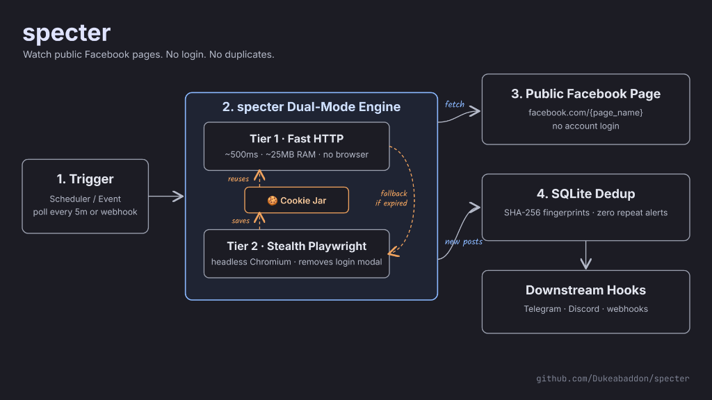

<div align="center">

**English** · [Filipino](docs/readme/README_fil.md) · [简体中文](docs/readme/README_zh.md)

# specter: Self-Hosted Facebook Public Page Scraper

### A resilient dual-mode engine for continuous Facebook public page monitoring.

**See a public page post. Extract it in sub-seconds without getting banned, paying for SaaS, or burning personal accounts.**

[](https://python.org)
[](https://playwright.dev)
[](#how-specter-works)
[](#anti-ban-architecture)
[](LICENSE)

<br/>

[Quick start](#quick-start) · [How specter works](#how-specter-works) · [Anti-ban architecture](#anti-ban-architecture) · [CLI reference](#cli-reference) · [Python API](#python-api-usage) · [Ecosystem](#ecosystem)

<code>git clone https://github.com/Dukeabaddon/specter.git</code>

<br/><br/>


</div>

---

> [!IMPORTANT]
> In late 2024, Meta permanently discontinued `mbasic.facebook.com`, which broke 95% of historical open-source Facebook scrapers. **specter** is an independent open-source engine built using the **[Reverse Engineer Anything (REA)](https://github.com/morluto/rea)** skill to reverse-engineer Meta's modern Comet React SPA and Relay SSR data streams.

---

## The Modern Facebook Problem

If you have tried using open-source Facebook scrapers recently, you likely noticed that **almost all of them are dead**:

- **The Death of mbasic:** In late 2024, Meta permanently killed `mbasic.facebook.com`. 95% of historical Python libraries (`kevinzg/facebook-scraper` with 3.3k stars, `facebook2rss`, RSS-Bridge) stopped working overnight.
- **Comet React SPA and Relay:** Facebook now forces all web traffic through an obfuscated React Single-Page Application using Relay, rendering traditional CSS selectors (`div._5v64`, `article[data-ft]`) completely obsolete.
- **Immediate Bot Walls:** Standard HTTP requests to Facebook public pages now return `HTTP 400 Bad Request` or redirect to checkpoint login barriers.
- **Account Disabling:** Supplying personal authenticated cookies (`c_user` / `xs`) frequently triggers suspicious activity verification or permanent account disabling within 48 hours.
- **SaaS Lock-In:** Cloud scraper services (Apify, Bright Data, Scrapfly) charge upwards of $50–$150/month for basic scheduled page scraping.

`specter` was engineered to solve this challenge as a standalone, free, and self-hosted engine.

---

## How specter Works

<div align="center">
  
</div>

<br/>

Using the **Reverse Engineer Anything (REA)** methodology alongside deep inspection of commercial actors (Apify) and open-source codebases, we discovered three key architectural insights:

1. **Anonymous Visitor Cookies:** Public Facebook pages do not require account login. When an authentic browser visits a page, Meta edge servers issue ephemeral public visitor cookies (such as `datr` and `wd`).
2. **Inline Relay SSR Stream:** Modern Facebook pages do not initially load posts via GraphQL AJAX requests. Instead, the first batch of timeline posts is server-rendered directly into inline `<script type="application/json">` tags using Meta's `RelayPrefetchedStreamCache`.
3. **The Dual-Mode Hybrid Architecture:** By pairing a stealth browser engine with a lightweight HTTP client, we created a self-healing pipeline:
   - **Tier 1 (Fast HTTP):** Executes in ~500ms, consumes ~25MB of RAM, and parses the inline Relay SSR payload without launching Chromium.
   - **Tier 2 (Stealth Playwright):** Launches automatically when cookies expire, suppresses the login dialog overlay, unlocks DOM scrolling, scrapes live cards, and saves fresh visitor session tokens to `data/cookies.json` to re-arm Tier 1.

---

## Key Features

- **Sub-Second Fast Mode (Tier 1):** Parses inline Relay SSR JSON payloads via HTTP in **~500ms** with virtually zero CPU/memory overhead.
- **Stealth Headless Fallback (Tier 2):** When visitor cookies expire or Meta updates edge tokens, a stealth Playwright Chromium instance automatically launches, removes login dialog overlays, unlocks DOM scrolling, scrapes live virtualized feed cards, and refreshes the local cookie jar.
- **100% Cookieless and Account-Safe:** Runs strictly on anonymous visitor sessions. **No personal Facebook accounts, passwords, or session cookies are ever required.**
- **Deterministic SQLite Deduplication:** Content SHA-256 fingerprinting ensures that already-seen posts are never re-reported or duplicated.
- **Pluggable Downstream Pipeline:** Easily hook up downstream processors (custom notification webhooks, Discord/Telegram bots, event parsers, or keyword classifiers).

---

## Quick Start

### 1. Prerequisites
- Python 3.10+
- macOS, Linux, or Windows (WSL recommended)

### 2. Installation
```bash
# Clone the repository
git clone https://github.com/Dukeabaddon/specter.git
cd specter

# Create virtual environment
python3 -m venv .venv
source .venv/bin/activate

# Install dependencies and Playwright browser
pip install -r requirements.txt
playwright install chromium
```

### 3. Run a Live Test Scrape
Scrape any public Facebook page (e.g. `QCGov`, `NASA`, `Meta`):
```bash
python3 main.py --page QCGov --limit 3
```

Sample output:
```text
Running single poll on 'QCGov' with mode='auto'...
[INFO] Attempting Tier 1 (Fast HTTP) for 'QCGov'...
[INFO] GET https://www.facebook.com/QCGov
[INFO] Extracted 1 posts from HTTP response in 0.58s!
[INFO] Tier 1 HTTP succeeded with 1 posts!
[INFO] NEW POST [pfbid02cGhjwL7P...] from QCGov

=== Poll Complete ===
New Posts Stored: 1
```

---

## CLI Reference

| Command | Description |
|---|---|
| `python3 main.py --page <NAME>` | Poll a specific public page once (e.g. `QCGov`, `cnn`, `bbcnews`) |
| `python3 main.py --page <NAME> --mode auto` | **Default**: Fast HTTP first, stealth Playwright fallback |
| `python3 main.py --page <NAME> --mode http` | Force HTTP-only mode |
| `python3 main.py --page <NAME> --mode playwright` | Force Playwright browser mode |
| `python3 main.py --page <NAME> --monitor --interval 300` | Run continuous monitoring daemon every 5 minutes (300s) |
| `python3 main.py --db-list` | Display recent stored posts from SQLite database |
| `python3 main.py --test-classifier` | Run built-in sample downstream event classification test |

---

## Anti-Ban Architecture: How It Survives

| Challenge | Naive Scrapers | specter Solution |
|---|---|---|
| **Account Ban Risk** | Use personal logged-in cookies | **Zero credentials used**. Runs on anonymous visitor sessions |
| **Login Modal Wall** | Scraper halts when modal appears | Injects script to delete `div[role="dialog"]` and restore `overflow: auto` |
| **Browser Bloat** | Runs heavy browser 24/7 | Playwright runs **once** to capture session; subsequent scrapes use **lightweight HTTP** |
| **IP Rate Limiting** | Spamming identical requests | Built-in polling intervals + randomized headers + automatic fallback cooling |
| **Cloud Datacenter IPs** | AWS/GCP IPs flagged by Meta WAF | Supports residential proxy forwarding via standard `HTTP_PROXY` env vars |

---

## Python API Usage

You can embed `specter` directly into your own applications:

```python
from src.fetchers.hybrid import HybridFetcher
from src.storage.db import PostDatabase

# Initialize dual-mode fetcher
fetcher = HybridFetcher(mode="auto")

# Fetch latest posts
posts = fetcher.fetch_posts("QCGov", limit=5)

for post in posts:
    print(f"[{post.post_id}] {post.url}")
    print(post.text[:200])
    print("Images:", post.images)
```

---

## Roadmap

- [x] Reverse-engineer modern Meta Comet React SPA and Relay architecture
- [x] Dual-mode hybrid fetcher (Fast HTTP + Stealth Playwright fallback)
- [x] Automated login dialog suppression and virtualized feed scrolling
- [x] SQLite deduplication engine
- [ ] Multi-page concurrent polling worker pool
- [ ] Direct webhook emitter (Discord, Telegram, Slack, custom HTTP POST)
- [ ] Headless Docker container with pre-installed Chromium

---

## Ecosystem and Acknowledgments

- Built using the **[Reverse Engineer Anything (REA)](https://github.com/morluto/rea)** skill.
- Optimized with **[Gate-MCP](https://github.com/Dukeabaddon/Gate-MCP)** for context-efficient agent development.
- Designed as a robust data extraction subsystem for downstream civic and monitoring projects (such as OpenSuspension-PH).

---

## Disclaimer

This project is an independent open-source research tool designed for automated collection of publicly accessible web content. Users are responsible for complying with applicable website terms of service and local data protection regulations.

---

<div align="center">

### Star History

[](https://star-history.com/#Dukeabaddon/specter&Date)

</div>
